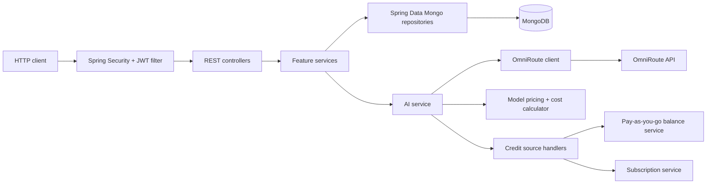
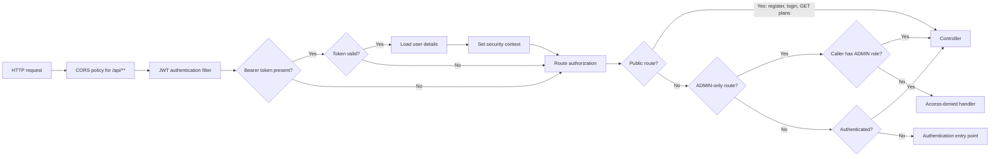
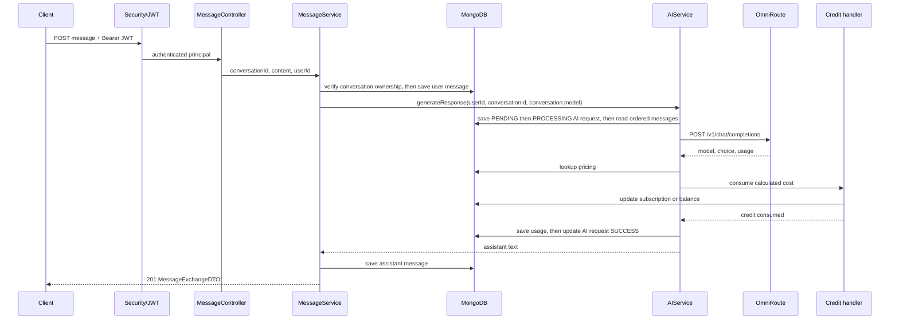

# System Architecture

## Scope and style

The application is a single Spring Boot service using a conventional controller → service → repository layering. MongoDB stores domain documents; a dedicated `OmniRouteClient` adapter calls the configured AI gateway. It is not split into separately deployable modules in this repository.

## Component view

## Package responsibilities

| Package | Responsibility |
|---|---|
| `auth`, `security`, `config` | Registration/login, JWT issuance and request authentication, security rules, CORS, property binding. |
| `user` | User document, profile/admin operations, roles/status, selected credit source. |
| `conversation`, `message` | Conversation lifecycle, conversation-scoped messages, DTO mapping and AI message exchange. |
| `ai`, `omniroute` | AI request lifecycle, gateway request/response mapping and model catalog retrieval. |
| `model_pricing`, `usage_record`, `credit`, `user.user_balance` | Price lookup, cost calculation, usage aggregates, credit selection and consumption. |
| `plan`, `subscription`, `transaction` | Plans, subscription lifecycle and transaction records. No external payment gateway was found. |
| `ticket`, `kpi`, `admin` | User/admin support tickets, ticket history and administrative endpoints/aggregates. |
| `exception` | Application error response and exception-to-status mapping. |

Controllers use DTOs and mappers where present; Mongo document classes generally carry scalar ID fields rather than embedded objects or `@DBRef` references.

## Request lifecycle and security

1. Spring Security applies stateless session policy and runs `JwtAuthenticationFilter` before username/password authentication.
2. The filter parses a bearer token, validates it using `JwtTokenProvider`, loads user details, and sets the security context.
3. Public routes are registration, login, and `GET /api/plans`; `/api/admin/**` and selected user-management routes require `ADMIN`; remaining routes require authentication.
4. Controllers obtain user identity from the authenticated principal for user-scoped operations.
5. Services enforce business rules and ownership checks, then call repositories or integrations.
6. `GlobalExceptionHandler` maps application exceptions into `ErrorResponse`; authentication entry-point and access-denied handlers separately handle security-filter failures.

CORS uses the explicit `cors.allowed-origins` allowlist (default `http://localhost:5173`), methods GET/POST/PUT/PATCH/DELETE/OPTIONS, and Authorization/Content-Type headers, for `/api/**`. Wildcard origins are rejected; authentication rules are unchanged.

The JWT filter continues the chain when a token is absent, non-Bearer, or invalid; route authorization still decides access. The ADMIN-only set includes `/api/admin/**`, the listed user-management endpoints, and `PUT /api/users/*/role`; `GET /api/users/me` and other non-public routes require authentication.

## Representative AI message sequence

This depicts the successful path. Provider and other exceptions update the AI request to `PROVIDER_ERROR` or `FAILED` before propagating; the user message has already been saved in the earlier service step and is not rolled back by a documented Mongo transaction.

## Persistence and integration

Spring Data Mongo repositories use `MongoRepository`; several custom repository implementations use `MongoTemplate` for filtered, paginated queries and KPI aggregations. Mongo indexes are enabled through `spring.data.mongodb.auto-index-creation=true`, with index declarations on selected document classes. See [data model](DATA_MODEL.md).

`OmniRouteClientImpl` uses Spring `RestClient` with configured base URL, bearer API key, `/v1/models`, and `/v1/chat/completions`. Its Java HTTP client has a 30-second connection timeout and a positive configurable read/response deadline (`omniroute.read-timeout`, default 120 seconds), without automatic retries. The catalog is mapped from the gateway's `data` array. AI usage and model are read from the gateway response, then pricing is looked up locally.

## Architectural caveats

- Mongo IDs are represented as scalar strings; the database does not enforce relational foreign keys for those fields.
- Multi-document business operations (registration plus balance creation, message exchange, subscription plus transaction, and balance purchase) are sequential service calls; no multi-document transaction annotation/session was found in the inspected flow.
- `SendMessageRequest` declares a model property, but the controller passes only content and identity; generation uses the conversation's stored model.
- There is no Swagger/OpenAPI setup or deployment/container definition found in the repository.
