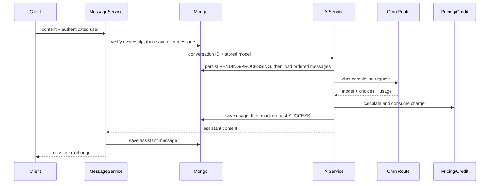
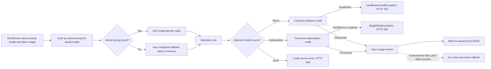
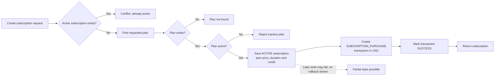

# Business Flows

This document describes service behavior visible in the current implementation. Multi-step operations are sequential MongoDB writes unless otherwise stated; no transaction guarantee is claimed.

## Registration and login

1. `POST /api/auth/register` validates username, email, password, first name and last name (all nonblank; email format checked).
2. `AuthServiceImpl` checks for existing username/email, hashes the password with BCrypt, creates an active `USER`, and saves it.
3. It creates a zero/default balance through `UserBalanceService`, stores the resulting balance ID on the user, and saves the user again.
4. The controller returns `201 Created` with no body.
5. Login authenticates username/password through Spring Security and returns a signed JWT string. JWT lifetime is one hour.

The registration writes are not shown as atomic. A failure between user and balance writes could leave partial state. Unique database indexes additionally protect username/email, but duplicate-key errors are mapped to conflict.

## Conversation and AI message

1. The authenticated principal supplies `userId`; the client cannot set owner identity through the controller.
2. Conversation creation chooses the requested model or the configured catalog default. The configured default is accepted without checking gateway membership; other models must appear in the gateway catalog. It creates an `ACTIVE` conversation.
3. Message submission validates nonblank content and verifies the caller owns the conversation.
4. The service saves a user message, then calls AI generation using the conversation's stored model. The request DTO's `model` property is not passed through by the controller.
5. AI service persists `AIRequest` as `PENDING`, then `PROCESSING`; reads all conversation messages ordered by creation time; sends their roles/content to OmniRoute.
6. On successful response, the service uses the provider-returned model and token usage, looks up active pricing for that model, calculates cost, consumes the selected credit source, saves usage, marks the AI request `SUCCESS`, then returns the assistant text. The message service saves the assistant message and returns the exchange with `201`.

On provider exception, AI status is marked `PROVIDER_ERROR`; other caught exceptions mark `FAILED`. These updates are followed by rethrow. Usage is not recorded if failure occurs before its save. Since the user message is saved before generation and no encompassing transaction is shown, failed AI generation may leave that user message persisted without an assistant reply.

## Pricing, usage and credit

- `OmniRouteUsage` supplies prompt, completion and total token counts; backend cost uses prompt/completion counts and per-million input/output prices.
- `CostCalculator` computes each component as tokens × price-per-million ÷ 1,000,000, using `BigDecimal` division at scale 12 with `HALF_UP`, then adds the components. It does not round the final sum further.
- The actual model string returned by OmniRoute selects active model pricing. If no active model-specific pricing exists, the service uses configured default input/output rates in memory; it does not persist that fallback. The `ModelPricingNotFoundException` 422 handler is not reached by this branch.
- The usage record stores provider cost and charged amount as the same calculated amount.
- The user's configured `CreditSource` selects a handler, with no automatic fallback to another source. Subscription credit checks expiration and remaining amount; pay-as-you-go delegates to balance consumption. Insufficient balance raises `InsufficientCreditException` (422). Subscription expiration/insufficiency currently raises `IllegalStateException` (generic 500). No selected credit source maps to 400; setting the selection to null clears it.
- Credit is consumed before usage record and AI-request success writes. A later persistence failure could therefore leave a charge without corresponding usage/success records; no transaction is shown.

There is no automatic switch to another credit source. The debit precedes usage and request-success persistence, and those writes are not an atomic transaction.

## Subscription and balance operations

- Subscription creation checks plan existence/activity and existing active subscription, builds subscription dates/credit from plan values, and writes a related successful transaction. There is no external payment processor call in the inspected flow; do not interpret the transaction as proof of settled payment.
- Credit purchase accepts amount/currency/reference, creates a transaction and updates the user's balance through service logic. It does not integrate with an external payment provider in the inspected repository.
- These related writes are sequential and not documented as atomic. Administrative transaction status updates are separate routes.

The transaction records local application state; no external payment provider is called. Subscription persistence and transaction creation/status updates are sequential, not an atomic purchase operation.

## Support tickets

- An authenticated user creates a ticket associated with their identity; listing is scoped to that user, with optional search/status and pageable results.
- Administrators can list/filter tickets, read details, add replies and change status.
- Reply and status-change operations create ticket-history records. The history is persisted separately from ticket state; no multi-document atomicity is established.

## KPI and summaries

Admin KPI endpoints expose summary and usage data. Repository custom implementations use Mongo aggregation for counts, successful/failed AI statuses, usage totals/daily series and transaction summaries. Time-range details and returned fields are defined by the KPI DTO/controller rather than this general workflow description; see [API protocol](API_PROTOCOL.md).

Related: [architecture](ARCHITECTURE.md), [data model](DATA_MODEL.md).
