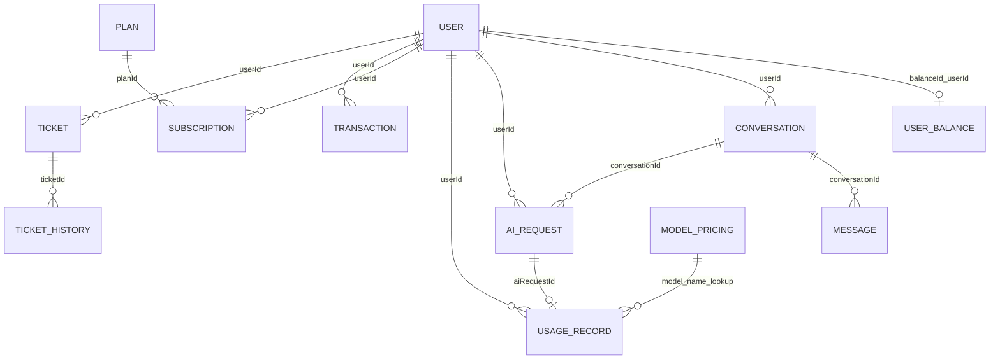

# Data Model and Persistence

MongoDB documents use string IDs annotated with Spring Data `@Id`. Cross-document links are plain scalar IDs, not MongoDB `@DBRef` values, embedded documents, or enforced relational foreign keys. Collection names and indexes below come from model annotations. Index creation is enabled by `spring.data.mongodb.auto-index-creation=true`; actual database index state depends on runtime startup and MongoDB.

No model classes declare Bean Validation constraints. Reference fields are nullable at the Java/model level unless service logic requires them. Most classes use Lombok builders; no `@Builder.Default` model defaults were found. Service flows may initialize fields when creating documents. Local date/time fields use `LocalDateTime`.

## Persisted documents

| Model / collection | Fields (Java types) | Declared indexes |
|---|---|---|
| `User` / `users` | `id:String`, `balanceId:String`, `creditSource:CreditSource`, `username:String`, `password:String`, `firstName:String`, `lastName:String`, `email:String`, `userRole:UserRole`, `status:UserStatus`, `createdAt:LocalDateTime`, `updatedAt:LocalDateTime` | Unique `username`; unique `email`; compound `(userRole, status)`. |
| `UserBalance` / `user_balances` | `id:String`, `userId:String`, `balance:BigDecimal`, `currency:String`, `createdAt:LocalDateTime`, `updatedAt:LocalDateTime` | Unique `userId`. |
| `Conversation` / `conversations` | `id:String`, `userId:String`, `title:String`, `model:String`, `status:ConversationStatus`, `createdAt:LocalDateTime`, `updatedAt:LocalDateTime` | `(userId, updatedAt DESC)`; `(userId, status, updatedAt DESC)`. |
| `Message` / `messages` | `id:String`, `conversationId:String`, `role:MessageRole`, `content:String`, `createdAt:LocalDateTime` | `(conversationId, createdAt DESC)`. |
| `AIRequest` / `ai_requests` | `id:String`, `userId:String`, `conversationId:String`, `requestedModel:String`, `actualModel:String`, `status:AIRequestStatus`, `requestTime:LocalDateTime`, `responseTime:LocalDateTime` | `status`; `requestTime`. |
| `UsageRecord` / `usage_records` | `id:String`, `aiRequestId:String`, `userId:String`, `conversationId:String`, `model:String`, `inputTokens:long`, `outputTokens:long`, `totalTokens:long`, `providerCost:BigDecimal`, `chargedAmount:BigDecimal`, `timestamp:LocalDateTime` | None declared. |
| `ModelPricing` / `model_pricing` | `id:String`, `model:String`, `inputPricePerMillion:BigDecimal`, `outputPricePerMillion:BigDecimal`, `active:boolean`, `createdAt:LocalDateTime`, `updatedAt:LocalDateTime` | None declared; admin upsert uses a model lookup. |
| `Plan` / `plans` | `id:String`, `name:String`, `price:BigDecimal`, `duration:int`, `creditLimit:BigDecimal`, `active:boolean`, `createdAt:LocalDateTime`, `updatedAt:LocalDateTime` | None declared. |
| `Subscription` / `subscriptions` | `id:String`, `userId:String`, `planId:String`, `pricePaid:BigDecimal`, `startDate:LocalDateTime`, `endDate:LocalDateTime`, `status:SubscriptionStatus`, `remainingCredit:BigDecimal` | `(userId, status)`; `planId`. |
| `Transaction` / `transactions` | `id:String`, `userId:String`, `type:TransactionType`, `amount:BigDecimal`, `currency:String`, `status:TransactionStatus`, `reference:String`, `createdAt:LocalDateTime` | None declared. |
| `Ticket` / `tickets` | `id:String`, `userId:String`, `subject:String`, `description:String`, `status:TicketStatus`, `createdAt:LocalDateTime`, `updatedAt:LocalDateTime` | `(userId, createdAt DESC)`. |
| `TicketHistory` / `ticket_history` | `id:String`, `ticketId:String`, `userId:String`, `type:TicketHistoryType`, `status:TicketStatus`, `message:String`, `createdAt:LocalDateTime` | `(ticketId, createdAt ASC)`. |

## Relationships (scalar references)

The diagram shows application-level references and lookup semantics inferred from fields/services, not guaranteed cardinality or database constraints. Model pricing is looked up by model string; there is no pricing document ID stored on a usage record.

## Monetary storage verification

The installed default mapper/driver writes `BigDecimal` values as BSON Decimal128; isolated fixtures verified balance/subscription values at multiple scales. Existing deployment overrides and historical records were not inspected. Seeded string-backed amounts could be read as `BigDecimal` but did not match a default mapped Decimal128 equality query. No monetary representation or production accounting-write strategy was changed. See [known issues](KNOWN_ISSUES.md) before designing atomic updates/migrations.

## Lifecycle and validation notes

- Registration sets user role to `USER`, status to `ACTIVE`, hashes password, writes timestamps, creates a balance and then stores its ID on the user. These are separate saves.
- Conversation creation sets status `ACTIVE` and timestamps; archive sets `ARCHIVED`. Deletion removes the conversation's messages before deleting the conversation.
- AI requests begin `PENDING`, are marked `PROCESSING`, then success or failure status with response time. Usage records are created only after successful provider response, price lookup, and credit consumption.
- Ticket history is stored in its own collection with scalar ticket and user IDs.
- Request DTO validation is distinct from model validation. For example, registration request fields have `@NotBlank` and email has `@Email`; that does not make the Mongo model itself constrained.

For repository query and pagination behavior see [API protocol](API_PROTOCOL.md) and [architecture](ARCHITECTURE.md). Source model declarations are under `src/main/java/dev/ramtin/aiplatform/` in each feature package.
